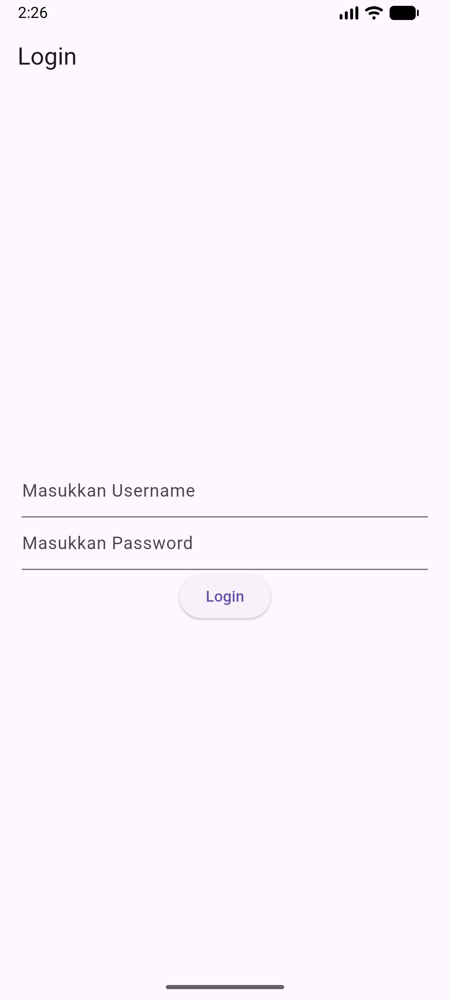
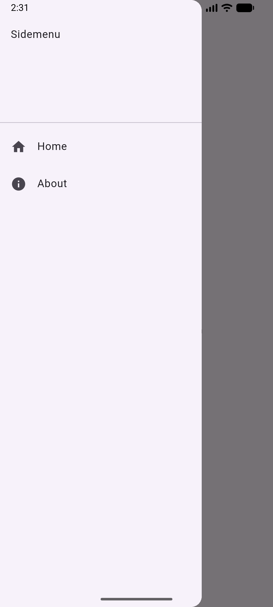

# Identitas Praktikan
- **Nama:** Hana Naila Rahmadina
- **NIM:** H1D024093
- **Shift KRS:** Shift D
- **Shift Sekarang:** Shift I

---

## Hasil Praktikum Modul 3 (Navigasi Routing, Side Menu Drawer & SharedPreferences)

Pada praktikum Modul 3 ini, saya mempelajari konsep routing halaman dan penyimpanan data lokal pada Flutter:
- Menerapkan navigasi antar halaman (*Routing*) menggunakan `Navigator.push` dan `Navigator.pushReplacement` untuk perpindahan alur antarmuka pengguna.
- Membangun halaman login (`LoginPage`) dengan validasi input dan penyimpanan username ke penyimpanan lokal menggunakan package `shared_preferences`.
- Menampilkan drawer menu navigasi samping (`Sidemenu`) yang memfasilitasi navigasi cepat menuju halaman utama, halaman informasi, dan aksi logout.
- Membaca data sesi pengguna secara asinkron (`async`/`await`) pada `HomePage` untuk menampilkan nama pengguna yang sedang aktif.
- Menyediakan halaman `AboutPage` sebagai informasi aplikasi dan menangani pembersihan data sesi lokal saat pengguna keluar (*logout*).

### Dokumentasi Screenshot

| Form Login | Halaman Home |
| :---: | :---: |
|  |  |
| **Side Menu (Drawer)** | **Halaman About** |
|  |  |
