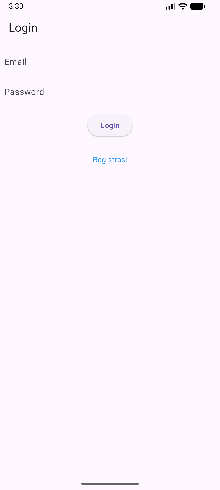
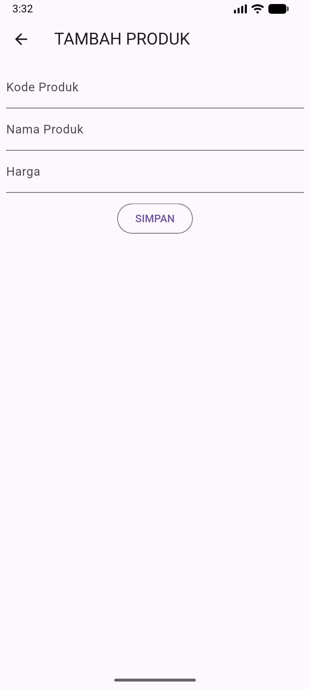
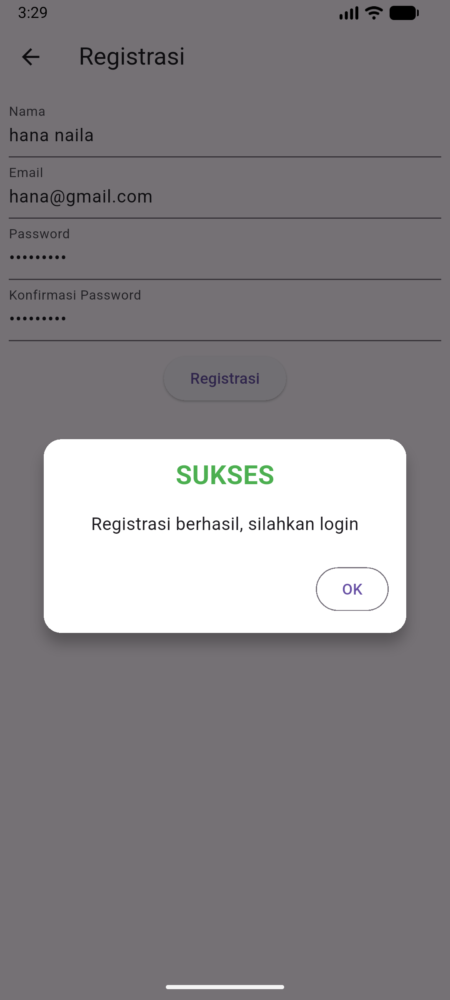
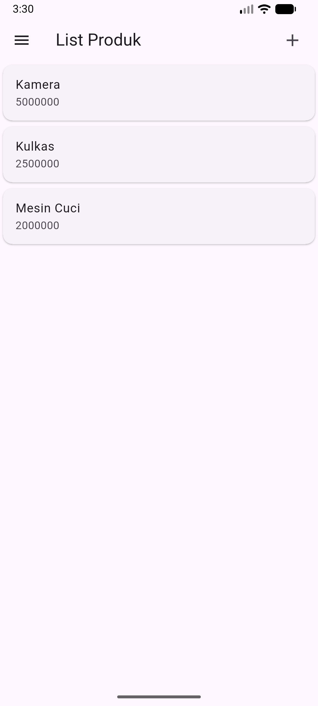
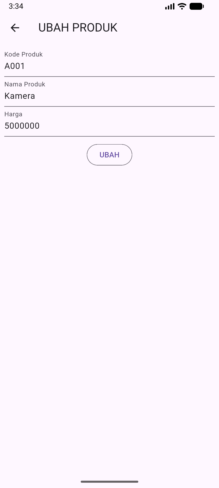
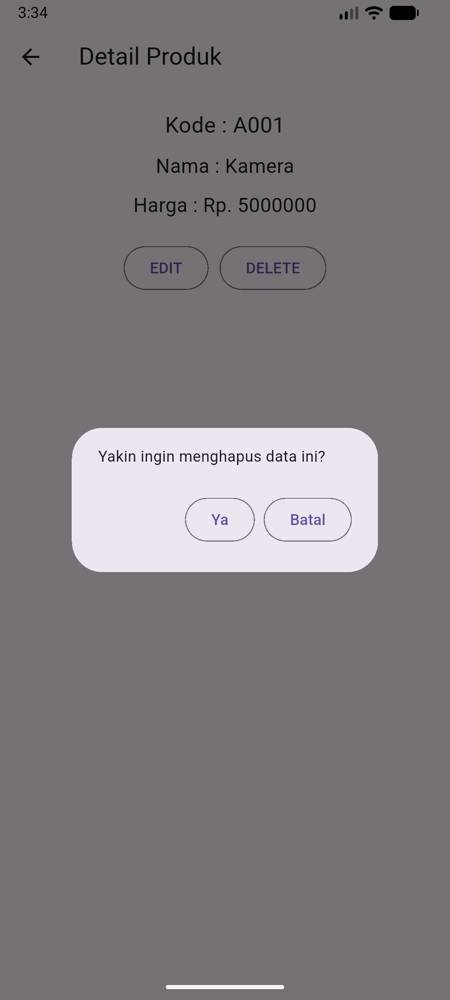
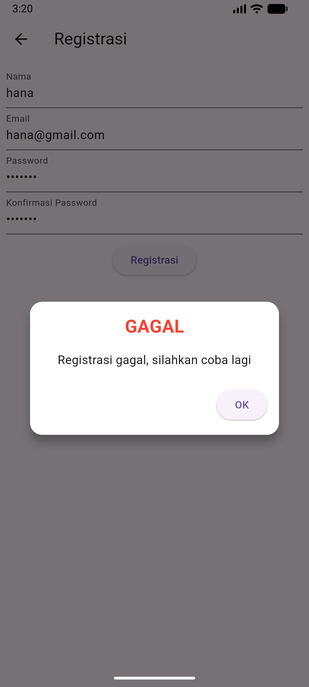

# Identitas Praktikan
- **Nama:** Hana Naila Rahmadina
- **NIM:** H1D024093
- **Shift KRS:** Shift D
- **Shift Sekarang:** Shift I

---

## Hasil Praktikum Modul 4 (Perancangan REST API CodeIgniter 4 & Model UI Toko Kita)

Pada praktikum Modul 4 ini, saya merancang backend RESTful API serta antarmuka dasar aplikasi Toko Kita pada Flutter:
- Membangun RESTful API menggunakan framework CodeIgniter 4 (`toko-api`) dengan basis data MySQL (`toko_api`) untuk mengelola tabel `member`, `member_token`, dan `produk`.
- Mengimplementasikan endpoint API registrasi member (`POST /registrasi`), autentikasi login dengan *auth token* (`POST /login`), serta operasi CRUD produk (`GET /produk`, `POST /produk`, `PUT /produk/{id}`, `DELETE /produk/{id}`).
- Membuat model serialisasi data pada Flutter (`Produk`, `Login`, `Registrasi`) dengan metode `fromJson` untuk memetakan respons JSON dari REST API ke objek Dart.
- Merancang antarmuka awal aplikasi Toko Kita yang terdiri dari halaman Registrasi (`RegistrasiPage`), halaman Login (`LoginPage`), daftar katalog produk (`ProdukPage`), form tambah/edit produk (`ProdukForm`), dan detail produk (`ProdukDetail`).

### Dokumentasi Screenshot Modul 4

| Form Registrasi | Form Login |
| :---: | :---: |
|  |  |
| **Form Tambah Produk** | **Detail Produk** |
|  |  |

---

## Hasil Praktikum Modul 5 (Integrasi REST API, Helper Modul, BLoC & Full CRUD Toko Kita)

Pada praktikum Modul 5 ini, saya menyelesaikan integrasi penuh aplikasi Flutter Toko Kita dengan backend RESTful API:
- Mengintegrasikan komunikasi HTTP antara aplikasi mobile Flutter dan backend REST API menggunakan package `http` serta persistensi sesi lokal melalui `shared_preferences`.
- Membangun modul helper pendukung: `UserInfo` untuk menyimpan token dan user ID, `AppException` untuk standarisasi penanganan galat (*error handling*), `Api` sebagai klien HTTP (GET, POST, DELETE) berotorisasi *Bearer Token*, dan `ApiUrl` untuk sentralisasi endpoint API.
- Mengimplementasikan arsitektur BLoC (*Business Logic Component*) melalui `RegistrasiBloc`, `LoginBloc`, `LogoutBloc`, dan `ProdukBloc` untuk memisahkan alur logika bisnis API dari layer presentasi UI.
- Membuat widget dialog kustom (`SuccessDialog` dan `WarningDialog`) untuk menampilkan pesan status operasi secara jelas dan responsif kepada pengguna.
- Menyempurnakan alur antarmuka pengguna: auto-login pada `main.dart` berbasis ketersediaan token, registrasi akun baru, login dan logout sesi, visualisasi katalog produk dinamis via `FutureBuilder`, serta operasi manipulasi data (Create, Read, Update, Delete) produk secara *real-time* ke basis data MySQL.

### Dokumentasi Screenshot Modul 5

| Registrasi Berhasil | List Produk (REST API) |
| :---: | :---: |
|  |  |
| **Form Ubah Produk (Update)** | **Dialog Hapus Produk (Delete)** |
|  |  |
| **Validasi / Registrasi Gagal** | |
|  | |
