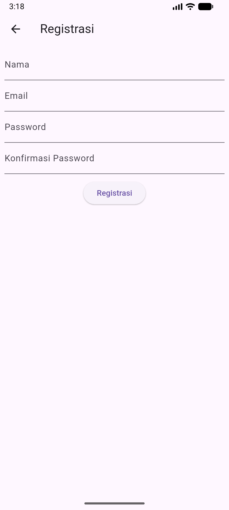

# Identitas Praktikan
- **Nama:** Hana Naila Rahmadina
- **NIM:** H1D024093
- **Shift KRS:** Shift D
- **Shift Sekarang:** Shift I

---

## Hasil Praktikum Modul 4 (Perancangan REST API CodeIgniter 4 & Model UI Toko Kita)

Pada praktikum Modul 4 ini, saya merancang backend RESTful API serta antarmuka dasar aplikasi Toko Kita pada Flutter:
- Membangun RESTful API menggunakan framework CodeIgniter 4 (`toko-api`) dengan basis data MySQL (`toko_api`) untuk mengelola tabel `member`, `member_token`, dan `produk`.
- Mengimplementasikan endpoint API registrasi member (`POST /registrasi`), autentikasi login dengan *auth token* (`POST /login`), serta operasi CRUD produk (`GET /produk`, `POST /produk`, `PUT /produk/{id}`, `DELETE /produk/{id}`).
- Membuat model serialisasi data pada Flutter (`Produk`, `Login`, `Registrasi`) dengan metode `fromJson` untuk memetakan respons JSON dari REST API ke objek Dart.
- Merancang antarmuka awal aplikasi Toko Kita yang terdiri dari halaman Registrasi (`RegistrasiPage`), halaman Login (`LoginPage`), daftar katalog produk (`ProdukPage`), form tambah/edit produk (`ProdukForm`), dan detail produk (`ProdukDetail`).

### Dokumentasi Screenshot Modul 4

| Form Registrasi | Form Login |
| :---: | :---: |
|  |  |
| **Form Tambah Produk** | **Detail Produk** |
|  |  |
