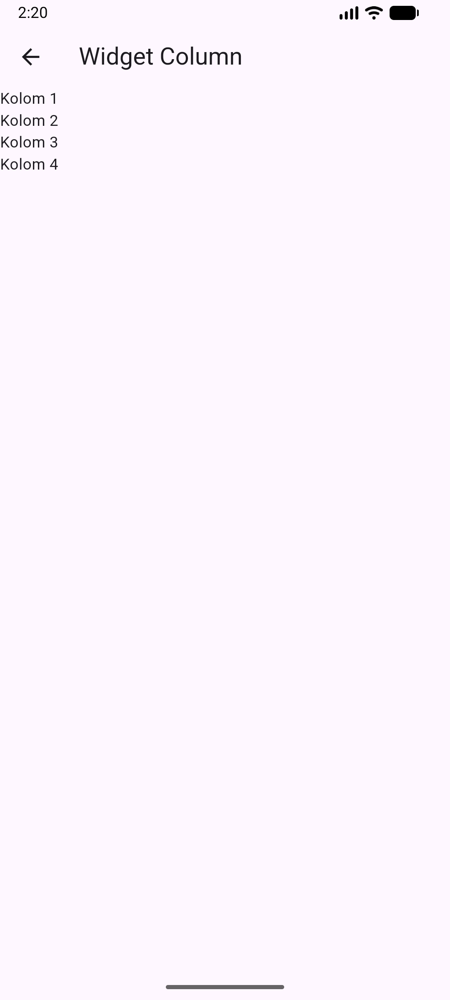
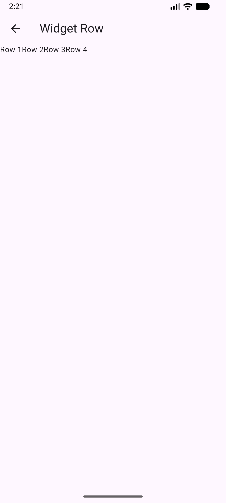
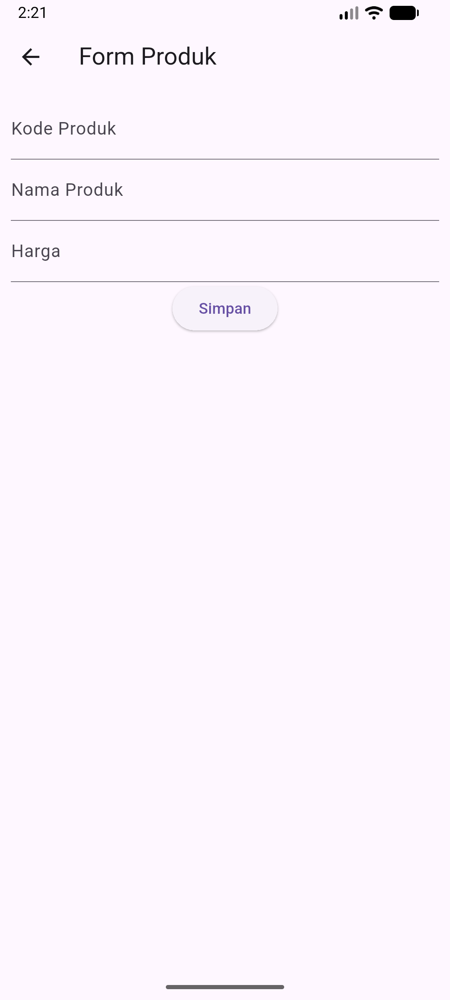
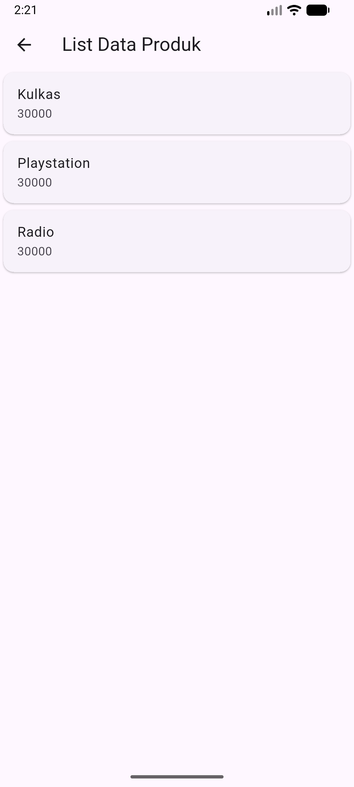

# Identitas Praktikan
- **Nama:** Hana Naila Rahmadina
- **NIM:** H1D024093
- **Shift KRS:** Shift D
- **Shift Sekarang:** Shift I

---

## Hasil Praktikum Modul 2 (Pengenalan & Desain Framework Flutter)

Pada praktikum Modul 2 ini, saya belajar dasar-dasar pengembangan aplikasi mobile menggunakan framework Flutter, mulai dari memahami struktur proyek hingga merancang antarmuka (UI). Hal-hal yang telah saya terapkan meliputi:
- Membuat tampilan awal aplikasi (*Hello World*) menggunakan `StatelessWidget`.
- Mengatur tata letak elemen antarmuka secara vertikal dengan widget `Column` dan horizontal dengan widget `Row`.
- Membuat form input data barang (`ProdukForm`) menggunakan `StatefulWidget` dan `TextEditingController` untuk menangkap input kode, nama, dan harga produk.
- Menerapkan navigasi antar halaman menggunakan `Navigator.push` untuk mengirimkan data produk dari form ke halaman `ProdukDetail`.
- Menampilkan daftar data produk secara terstruktur menggunakan widget `ListView` dengan tampilan `Card` dan `ListTile` pada `ProdukPage`.

### Dokumentasi Screenshot

| Hello World | Widget Column | Widget Row |
| :---: | :---: | :---: |
|  |  |  |
| **Form Produk** | **Detail Produk** | **List Data Produk** |
|  |  |  |
